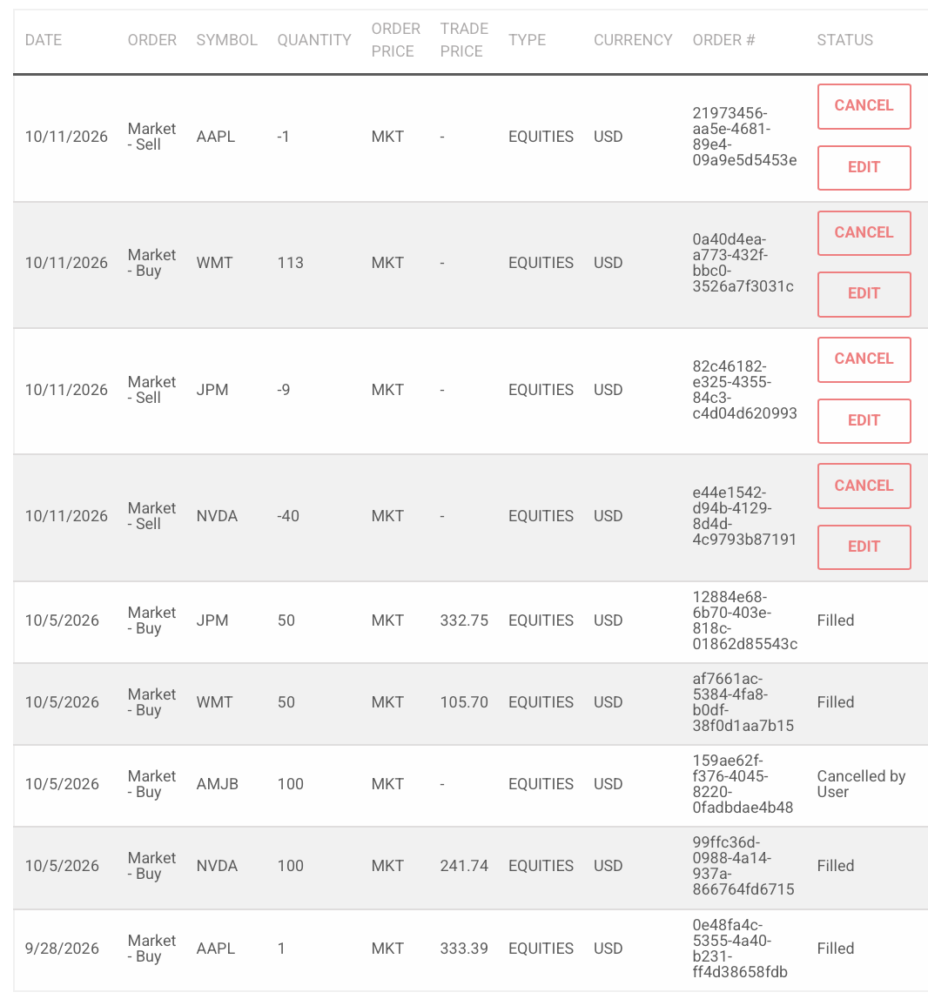
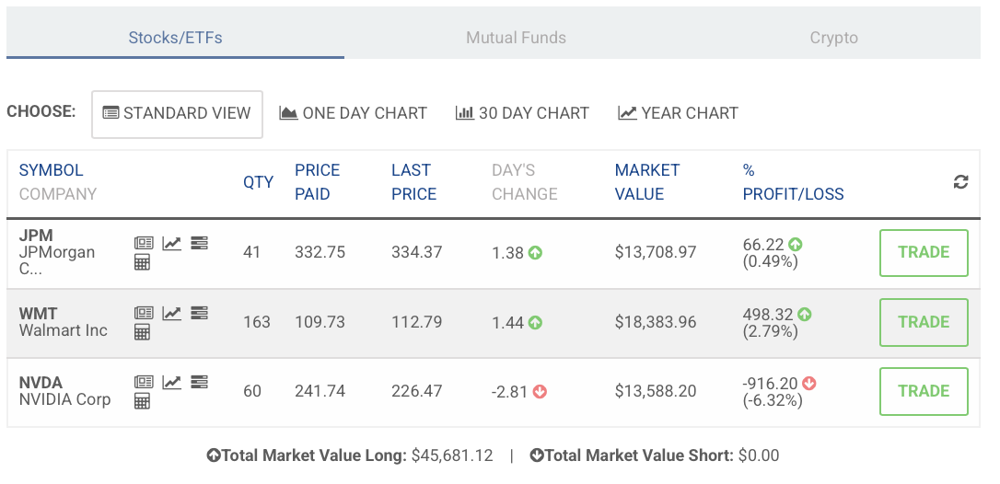
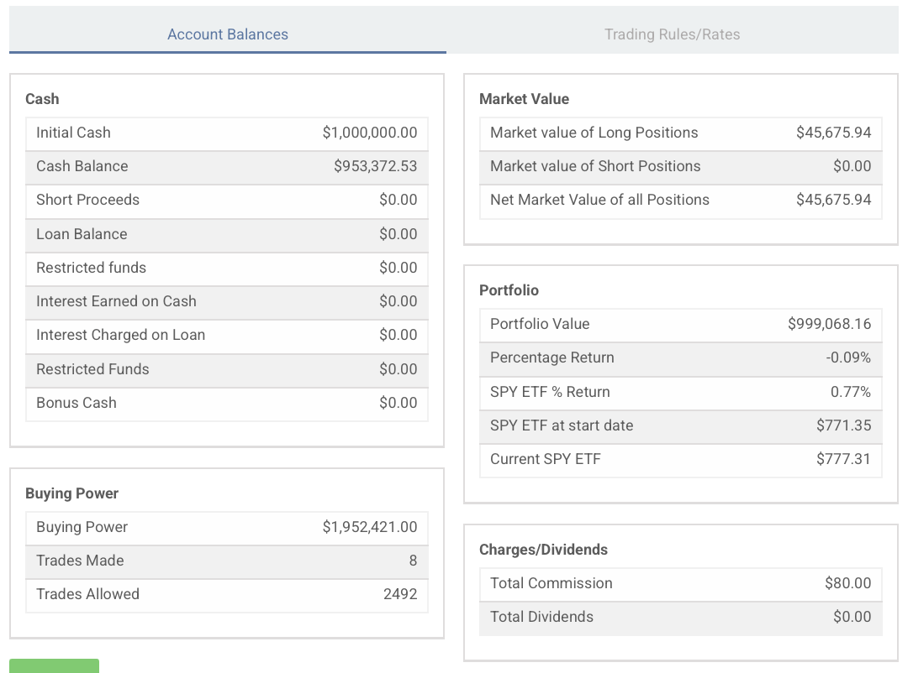

```{r setup, include=FALSE}
knitr::opts_chunk$set(echo = TRUE, warning = FALSE, message = FALSE)
```

## 1. Objetivo y datos

Se elaboran tres modelos nuevos de regresión lineal múltiple, uno para cada acción del portafolio (NVIDIA, JPMorgan y Walmart), con 5 variables independientes. Cada modelo conserva las 4 variables de la Actividad 3 (tres pares del sector y el S&P 500) y agrega como quinta variable **otra acción del portafolio**:

| Modelo | Variable dependiente | Variables independientes | Quinta variable (otra acción del portafolio) |
|---|---|---|---|
| 1 | NVIDIA (NVDA) | AMD, Broadcom, Microsoft, S&P 500 | JPMorgan |
| 2 | JPMorgan (JPM) | Bank of America, Wells Fargo, Goldman Sachs, S&P 500 | Walmart |
| 3 | Walmart (WMT) | Costco, Procter & Gamble, Coca-Cola, S&P 500 | NVIDIA |

La quinta variable conecta los modelos con la estrategia: si una acción del portafolio no explica a otra una vez que se controla por su sector y por el mercado, las posiciones se mueven por motores distintos y el portafolio está diversificado. Así se cubren los tres pares de acciones del portafolio (NVDA–JPM, JPM–WMT y WMT–NVDA).

**Datos.** Se usan los precios de cierre de 5 minutos descargados de Refinitiv (LSEG Workspace) para la Actividad 3, con la misma frecuencia para la variable dependiente y las independientes en los tres modelos:

- **Días:** jueves 8 y viernes 9 de octubre de 2026, solo en horario regular de mercado (de 7:30 a 14:00, hora de Monterrey).
- **Jueves incompleto:** el jueves inicia en el intervalo que cierra a las 11:25, el primero en que las 13 acciones tienen precio.
- **Salto nocturno:** se elimina el rendimiento del cierre del jueves a la primera barra del viernes.
- **Observaciones:** 108 rendimientos logarítmicos de 5 minutos por acción.
- **Archivos:** los 13 archivos xlsx de Refinitiv se consolidaron en `datos_5min.csv`.
- **Frecuencia:** se eligen 5 minutos porque en la Actividad 3 fue la frecuencia con suficientes observaciones para estimar con precisión; con 30 minutos (18 datos) se perdía la significancia individual por el tamaño de muestra.

```{r}
library(car)
library(lmtest)

datos5 <- read.csv("datos_5min.csv")
nrow(datos5)
```

## 2. Rendimientos logarítmicos de 5 minutos

```{r}
rend5 <- data.frame(
  nvda_ret = diff(log(datos5$nvda)),
  amd_ret  = diff(log(datos5$amd)),
  avgo_ret = diff(log(datos5$avgo)),
  msft_ret = diff(log(datos5$msft)),
  jpm_ret  = diff(log(datos5$jpm)),
  bac_ret  = diff(log(datos5$bac)),
  wfc_ret  = diff(log(datos5$wfc)),
  gs_ret   = diff(log(datos5$gs)),
  wmt_ret  = diff(log(datos5$wmt)),
  cost_ret = diff(log(datos5$cost)),
  pg_ret   = diff(log(datos5$pg)),
  ko_ret   = diff(log(datos5$ko)),
  spy_ret  = diff(log(datos5$spy))
)
# El renglón 32 es el rendimiento del cierre del jueves (14:00) a la primera barra del viernes (7:35)
rend5 <- rend5[-32, ]
nrow(rend5)
```

**Supuestos del modelo de regresión lineal múltiple que se revisan en cada modelo.** (1) No multicolinealidad perfecta ni severa entre las variables independientes, con correlaciones y VIF; (2) homoscedasticidad, es decir, varianza constante de los errores, con las pruebas Breusch-Pagan y Goldfeld-Quandt; y (3) no autocorrelación de los errores, con la prueba Durbin-Watson (Gujarati, cap. 12). Además, se revisa la forma de los residuales (simetría y valores extremos).

## 3. Modelo 1: NVIDIA

```{r}
modelo1n <- lm(nvda_ret ~ amd_ret + avgo_ret + msft_ret + spy_ret + jpm_ret, data = rend5)
summary(modelo1n)
confint(modelo1n)
```

**1. Prueba F (significancia conjunta).** H0: los cinco coeficientes de las variables independientes son iguales a cero; H1: al menos uno es distinto de cero. Con F = 19.50 (5 y 102 grados de libertad) y un p-valor de 1.4e-13, se rechaza H0 con mucha holgura: en conjunto, las cinco variables explican el rendimiento de NVIDIA cada 5 minutos. La F evalúa a todas las variables al mismo tiempo; cada prueba t evalúa una sola variable manteniendo constantes las demás.

**2. Bondad de ajuste.** El R² es de 0.489 y el R² ajustado de 0.464. Frente al modelo de 4 variables de la Actividad 3 (R² ajustado de 0.451), el ajustado sube, así que agregar a JPMorgan sí aporta información, aunque poca. El 51% de la variación de NVIDIA queda sin explicar y corresponde a factores no incluidos en el modelo.

**3. Coeficientes y niveles de significancia.** Los niveles de la tabla de R son: \*\*\* p < 0.001, \*\* p < 0.01, \* p < 0.05 y . p < 0.10. El S&P 500 es la variable más importante: significativo al 1% (\*\*), con un coeficiente de 1.03, es decir, si el mercado sube 1%, NVIDIA sube en promedio 1.03%, manteniendo constantes las demás. Broadcom (0.15) y Microsoft (0.15) son significativas al 5% (\*), mientras que AMD pierde fuerza y queda solo al 10% (.). JPMorgan tiene un coeficiente negativo (−0.20), significativo solo al 10% (., p = 0.067): cuando JPMorgan sube más de lo que explica el mercado, NVIDIA tiende a bajar ligeramente, lo que sugiere rotación entre sectores de crecimiento y de valor.

**4. Residuales.** El error estándar residual es de 0.00083, es decir, el modelo se equivoca en promedio 0.08% por intervalo. Los residuales van de −0.28% a +0.19% con una mediana prácticamente de cero; la distribución es aproximadamente simétrica, con una cola negativa un poco más larga.

**5. Intervalos de confianza.** Los intervalos del S&P 500 (0.37 a 1.68), Broadcom (0.02 a 0.29) y Microsoft (0.01 a 0.28) no incluyen el cero. Los de AMD (−0.01 a 0.19) y JPMorgan (−0.41 a 0.01) sí lo incluyen por muy poco, lo que confirma que su efecto es débil.

### 3.1 Supuestos del modelo 1

```{r}
cor(rend5$amd_ret,  rend5$spy_ret)
cor(rend5$avgo_ret, rend5$spy_ret)
cor(rend5$jpm_ret,  rend5$nvda_ret)
vif(modelo1n)
bptest(modelo1n)
gqtest(modelo1n)
dwtest(modelo1n)
```

**Multicolinealidad.** Todos los VIF están por debajo de 2.5: el más alto es el del S&P 500 (2.49), lo que significa que el 60% de su variación la explican las demás variables (1 − 1/2.49). JPMorgan tiene un VIF de 1.36, así que agregarla no generó multicolinealidad. **No se viola el supuesto.**

**Heteroscedasticidad.** Breusch-Pagan: H0 varianza constante; H1 la varianza depende de las variables del modelo. Con BP = 4.36 (5 grados de libertad) y p = 0.50, no se rechaza H0. Goldfeld-Quandt (H0: igual varianza en las dos mitades de la muestra; H1: mayor varianza en la segunda) da GQ = 0.53 con p = 0.98, y tampoco se rechaza. **No se viola el supuesto.**

**Autocorrelación.** Durbin-Watson: H0 no hay autocorrelación de primer orden en los errores; H1 hay autocorrelación positiva. El estadístico d = 2.05 está prácticamente en 2, el valor que corresponde a ρ = 0 (d ≈ 2(1 − ρ)), y con p = 0.63 no se rechaza H0. Con 108 observaciones y 5 variables, d está entre dU ≈ 1.78 y 4 − dU ≈ 2.22, la zona de no autocorrelación. **No se viola el supuesto:** el error de un intervalo de 5 minutos no ayuda a predecir el del siguiente, algo consistente con un mercado eficiente en su forma débil.

## 4. Modelo 2: JPMorgan

```{r}
modelo2n <- lm(jpm_ret ~ bac_ret + wfc_ret + gs_ret + spy_ret + wmt_ret, data = rend5)
summary(modelo2n)
confint(modelo2n)
```

**1. Prueba F.** H0: los cinco coeficientes son cero; H1: al menos uno es distinto de cero. Con F = 42.50 (5 y 102 grados de libertad) y un p-valor menor a 2.2e-16, se rechaza H0: es el modelo con la relación conjunta más fuerte de los tres.

**2. Bondad de ajuste.** El R² es de 0.676, el más alto de los tres modelos. Sin embargo, el R² ajustado (0.660) es prácticamente igual al del modelo de 4 variables (0.660): agregar a Walmart no mejora el modelo, y la pequeña subida del R² se debe solo a que hay una variable más.

**3. Coeficientes y niveles de significancia.** Bank of America (0.34) y Wells Fargo (0.21) son significativos al 0.1% (\*\*\*) y Goldman Sachs (0.17) al 1% (\*\*): si Bank of America sube 1%, JPMorgan sube en promedio 0.34%, manteniendo lo demás constante. El S&P 500 (p = 0.32) y Walmart (p = 0.34) no son significativos. JPMorgan se mueve con su sector, y una vez que se controla por los bancos, ni el mercado ni Walmart aportan información.

**4. Residuales.** El error estándar residual es de 0.0005 (0.05% por intervalo), el más bajo de los tres modelos. Los residuales van de −0.14% a +0.16% con mediana cercana a cero: una distribución simétrica y compacta.

**5. Intervalos de confianza.** Los intervalos de Bank of America (0.22 a 0.47), Wells Fargo (0.10 a 0.32) y Goldman Sachs (0.06 a 0.27) excluyen el cero. Los del S&P 500 (−0.13 a 0.41) y Walmart (−0.06 a 0.16) lo incluyen; el de Walmart, además, está muy cerca de cero en ambos extremos, lo que indica que su efecto sobre JPMorgan es prácticamente nulo.

### 4.1 Supuestos del modelo 2

```{r}
cor(rend5$bac_ret, rend5$wfc_ret)
cor(rend5$bac_ret, rend5$gs_ret)
cor(rend5$wmt_ret, rend5$jpm_ret)
vif(modelo2n)
bptest(modelo2n)
gqtest(modelo2n)
dwtest(modelo2n)
```

**Multicolinealidad.** El VIF más alto es el de Bank of America (1.98) y el de Walmart es de 1.04, el más bajo posible en la práctica: Walmart no comparte información con los bancos ni con el mercado. **No se viola el supuesto.**

**Heteroscedasticidad.** Con BP = 7.99 (5 grados de libertad) y p = 0.16, no se rechaza la varianza constante al 5%. Goldfeld-Quandt da GQ = 0.29 con un p-valor prácticamente de 1. **No se viola el supuesto.**

**Autocorrelación.** El estadístico d = 2.15, con p = 0.79, no permite rechazar H0. El valor está dentro de la zona de no autocorrelación (entre 1.78 y 2.22). **No se viola el supuesto.**

## 5. Modelo 3: Walmart

```{r}
modelo3n <- lm(wmt_ret ~ cost_ret + pg_ret + ko_ret + spy_ret + nvda_ret, data = rend5)
summary(modelo3n)
confint(modelo3n)
```

**1. Prueba F.** H0: los cinco coeficientes son cero; H1: al menos uno es distinto de cero. Con F = 18.00 (5 y 102 grados de libertad) y un p-valor de 9.2e-13, se rechaza H0: en conjunto, las variables explican a Walmart cada 5 minutos.

**2. Bondad de ajuste.** El R² es de 0.469 y el ajustado de 0.443, apenas por arriba del modelo de 4 variables (0.441). NVIDIA aporta muy poco al ajuste.

**3. Coeficientes y niveles de significancia.** Costco es la variable dominante: significativa al 0.1% (\*\*\*) y con el coeficiente más alto (0.62), es decir, si Costco sube 1%, Walmart sube en promedio 0.62%. Coca-Cola es significativa al 5% (\*, coeficiente de 0.29). P&G, el S&P 500 y NVIDIA no son significativos. El coeficiente de NVIDIA es negativo (−0.09), pero con p = 0.24 no es distinto de cero.

**4. Residuales.** El error estándar residual es de 0.00067 (0.07% por intervalo). Los residuales van de −0.23% a +0.19% con una mediana de cero, una distribución aproximadamente simétrica.

**5. Intervalos de confianza.** Costco (0.46 a 0.78) y Coca-Cola (0.06 a 0.53) excluyen el cero. Los de P&G (−0.17 a 0.23), el S&P 500 (−0.33 a 0.51) y NVIDIA (−0.24 a 0.06) lo incluyen.

### 5.1 Supuestos del modelo 3

```{r}
cor(rend5$pg_ret,   rend5$ko_ret)
cor(rend5$nvda_ret, rend5$spy_ret)
cor(rend5$nvda_ret, rend5$wmt_ret)
vif(modelo3n)
bptest(modelo3n)
gqtest(modelo3n)
dwtest(modelo3n)
```

**Multicolinealidad.** El VIF más alto es el de NVIDIA (1.74), por su correlación con el S&P 500 (0.59), pero está lejos del umbral de 5. **No se viola el supuesto.**

**Heteroscedasticidad.** Con BP = 4.03 (5 grados de libertad) y p = 0.55, y GQ = 0.70 con p = 0.89, no se rechaza la varianza constante. **No se viola el supuesto.**

**Autocorrelación.** El estadístico d = 2.21, con p = 0.87, no indica autocorrelación positiva. Es el valor más alejado de 2 de los tres modelos y queda justo en el límite de la zona de no autocorrelación (4 − dU ≈ 2.22), por lo que podría haber una autocorrelación negativa muy leve (correlación de los residuales consecutivos de alrededor de −0.12). Este patrón es común en datos de alta frecuencia, cuando el precio rebota entre el precio de compra y el de venta. **No se considera una violación del supuesto**, pero conviene vigilarlo si se usa una frecuencia aún menor.

## 6. Resumen de supuestos y recomendaciones de corrección

| Modelo | R² ajustado | VIF máximo | Breusch-Pagan (p) | Goldfeld-Quandt (p) | Durbin-Watson (p) | ¿Se viola algún supuesto? |
|---|---|---|---|---|---|---|
| 1. NVIDIA | 0.464 | 2.49 (SPY) | 0.50 | 0.98 | 2.05 (0.63) | No |
| 2. JPMorgan | 0.660 | 1.98 (BAC) | 0.16 | 1.00 | 2.15 (0.79) | No |
| 3. Walmart | 0.443 | 1.74 (NVDA) | 0.55 | 0.89 | 2.21 (0.87) | No (vigilar autocorrelación negativa leve) |

En ninguno de los tres modelos se detecta violación de los supuestos, así que los errores estándar, las pruebas t y los intervalos de confianza son confiables. Si en otra frecuencia o periodo apareciera alguna violación, las correcciones recomendadas serían:

- **Multicolinealidad (VIF mayor a 5):** eliminar la variable con mayor VIF, como en la Tarea 2, o sustituir dos acciones muy parecidas por una sola (por ejemplo, conservar solo un banco).
- **Heteroscedasticidad:** usar errores estándar robustos de White o transformar las variables; los coeficientes siguen siendo insesgados, pero los errores estándar de MCO dejan de ser válidos.
- **Autocorrelación:** estimar el modelo en primeras diferencias, agregar el rezago de la variable dependiente (modelo AR(1), visto en clase) o aplicar el método de Cochrane-Orcutt para estimar ρ. Antes de corregir, conviene revisar si la autocorrelación viene de una variable omitida o de una forma funcional incorrecta (Gujarati, pregunta 12.3).

## 7. Estrategia del portafolio

### 7.1 Situación inicial en HowMarketsWorks

El 5 y 6 de octubre se compraron las tres acciones del portafolio: 100 de NVIDIA a $241.74, 50 de JPMorgan a $332.75 y 50 de Walmart a $105.70. Además, hay 1 acción de Apple comprada el 29 de septiembre como prueba del simulador, antes de definir la estrategia.

```{r}
# Pesos de la parte invertida al cierre del 9 de octubre (valor de mercado)
valor_nvda <- 100 * 229.28
valor_jpm  <- 50 * 332.99
valor_wmt  <- 50 * 111.35
valor_aapl <- 1 * 336.64
total_inicial <- valor_nvda + valor_jpm + valor_wmt + valor_aapl
c(nvda = valor_nvda, jpm = valor_jpm, wmt = valor_wmt, aapl = valor_aapl) / total_inicial

# Beta de la parte invertida con las betas diarias de la Tarea 2 (sin Apple)
peso_nvda <- valor_nvda / total_inicial
peso_jpm  <- valor_jpm  / total_inicial
peso_wmt  <- valor_wmt  / total_inicial
peso_nvda * 2.05 + peso_jpm * 0.88 + peso_wmt * 0.39
```

**Diagnóstico.** La compra inicial quedó concentrada en NVIDIA: 50% del valor invertido, contra 37% de JPMorgan y 12% de Walmart. Con las betas diarias de la Tarea 2 (2.05, 0.88 y 0.39), la beta de la parte invertida es de alrededor de 1.40: un perfil agresivo, en el que un movimiento de 1% del mercado se traduce en un movimiento de 1.4% en las acciones del portafolio. Las acciones representan menos del 5% del portafolio total (alrededor de $45,500 de $1,000,000); el resto se mantiene en efectivo.

### 7.2 Lo que muestran los modelos

```{r}
# Correlaciones entre las acciones del portafolio (5 minutos)
cor(rend5$nvda_ret, rend5$jpm_ret)
cor(rend5$nvda_ret, rend5$wmt_ret)
cor(rend5$jpm_ret,  rend5$wmt_ret)

# Betas de 5 minutos (regresión simple contra el S&P 500)
beta_nvda <- lm(nvda_ret ~ spy_ret, data = rend5)
beta_jpm  <- lm(jpm_ret  ~ spy_ret, data = rend5)
beta_wmt  <- lm(wmt_ret  ~ spy_ret, data = rend5)
coef(beta_nvda)
coef(beta_jpm)
coef(beta_wmt)
```

- **Las tres posiciones se mueven por motores distintos.** En cada modelo, la acción del portafolio que se agregó como quinta variable no es significativa al 5%: JPMorgan no explica a NVIDIA (solo al 10% y con signo negativo), Walmart no explica a JPMorgan y NVIDIA no explica a Walmart. Las correlaciones entre ellas a 5 minutos son bajas o negativas (−0.10 entre NVIDIA y JPMorgan, −0.14 entre NVIDIA y Walmart y 0.17 entre JPMorgan y Walmart). Tener las tres diversifica el riesgo.
- **Cada acción responde a su sector, no a las otras posiciones.** NVIDIA depende del mercado y de los semiconductores, JPMorgan de los otros bancos y Walmart de Costco y Coca-Cola.
- **NVIDIA concentra el riesgo de mercado.** Es la única de las tres cuyo coeficiente del S&P 500 es significativo (1.03 en el modelo múltiple y una beta de 1.75 a 5 minutos). Con 50% del valor invertido, la mayor parte del riesgo del portafolio dependía de una sola acción.
- **Walmart es el ancla defensiva.** Su beta diaria es baja (0.39) y en el intradía prácticamente no se mueve con el mercado (−0.07), así que aumentar su peso reduce la sensibilidad del portafolio sin duplicar el riesgo de las otras posiciones.

### 7.3 Rebalanceo

Con base en los modelos, el 11 de octubre se colocaron órdenes de mercado para llevar la parte invertida a 30% NVIDIA, 30% JPMorgan y 40% Walmart, sin cambiar el monto total invertido. Las órdenes se ejecutaron a la apertura del lunes 12 de octubre.



```{r}
# Posiciones objetivo con los precios del 9 de octubre
nuevo_nvda <- 60  * 229.28   # vender 40
nuevo_jpm  <- 41  * 332.99   # vender 9
nuevo_wmt  <- 163 * 111.35   # comprar 113
total_nuevo <- nuevo_nvda + nuevo_jpm + nuevo_wmt
c(nvda = nuevo_nvda, jpm = nuevo_jpm, wmt = nuevo_wmt) / total_nuevo

# Beta de la parte invertida después del rebalanceo
(nuevo_nvda * 2.05 + nuevo_jpm * 0.88 + nuevo_wmt * 0.39) / total_nuevo
```

| Orden | Acciones | Motivo |
|---|---|---|
| Vender NVIDIA | 40 | Reducir de 50% a 30% la acción que concentra el riesgo de mercado |
| Vender JPMorgan | 9 | Ajustar de 37% a 30% |
| Vender Apple | 1 | Cerrar la posición de prueba, que no forma parte de ningún modelo |
| Comprar Walmart | 113 | Subir de 12% a 40% el ancla defensiva |

**Resultado del rebalanceo.** Las cuatro órdenes se ejecutaron el lunes 12 de octubre. Walmart se compró alrededor de $111.51 por acción, por lo que su precio promedio pasó de $105.70 a $109.73. Los pesos finales quedaron prácticamente en el objetivo.





```{r}
# Pesos y beta de la parte invertida después del rebalanceo (12 de octubre)
final_nvda <- 60  * 226.47
final_jpm  <- 41  * 334.37
final_wmt  <- 163 * 112.79
total_final <- final_nvda + final_jpm + final_wmt
c(nvda = final_nvda, jpm = final_jpm, wmt = final_wmt) / total_final
(final_nvda * 2.05 + final_jpm * 0.88 + final_wmt * 0.39) / total_final
```

| | Antes (9 de octubre) | Después (12 de octubre) |
|---|---|---|
| NVIDIA | 50.4% | 29.7% |
| JPMorgan | 36.6% | 30.0% |
| Walmart | 12.2% | 40.2% |
| Apple | 0.7% | 0% |
| Beta de la parte invertida | 1.40 | 1.03 |
| Perfil | Agresivo | Moderado |

La beta de la parte invertida bajó de 1.40 a 1.03, prácticamente la del mercado, y el monto invertido se mantuvo en alrededor de $45,700. Las cuatro operaciones costaron $40 en comisiones. El primer día ya muestra el efecto buscado: NVIDIA bajó 1.2% y Walmart subió 1.3%, así que el mayor peso del ancla defensiva compensó la caída de la acción de mayor beta.

**Aplicación de los modelos a la gestión del portafolio.**
1. **Rebalancear por peso.** Si NVIDIA pasa de 35% de la parte invertida, se vende para regresar a 30%, porque su beta alta hace que el riesgo crezca más rápido que su peso.
2. **No agregar más bancos ni más semiconductores.** Las acciones de cada sector están muy relacionadas entre sí, así que sumarlas aumentaría la concentración sin mejorar la diversificación.
3. **Vigilar a cada acción con su sector.** Las noticias de semiconductores para NVIDIA, de tasas y bancos para JPMorgan y de consumo y Costco para Walmart, porque son las variables que los modelos identificaron como significativas.

**Limitaciones.** Los modelos se estimaron con dos sesiones de mercado, así que describen el comportamiento de esos días y no garantizan que se mantenga. Relacionan rendimientos del mismo intervalo: sirven para medir la diversificación, no para pronosticar precios. Además, como el 95% del portafolio está en efectivo ($953,373 de $999,068), su rendimiento total (−0.09% contra 0.77% del S&P 500 desde el inicio) refleja sobre todo el efectivo; la estrategia se evalúa sobre la parte invertida.

## 8. Gujarati, capítulo 12: Autocorrelación (preguntas 12.1 a 12.3)

### Pregunta 12.1. Verdadero o falso

a. **Falso.** Con autocorrelación, los estimadores de MCO siguen siendo **insesgados** y consistentes (si no hay rezagos de la variable dependiente como regresores); lo que pierden es la **eficiencia**: ya no son MELI porque no tienen varianza mínima.

b. **Verdadero.** La prueba d de Durbin-Watson parte de los supuestos del modelo clásico, entre ellos que la varianza del error es constante. Si hay heteroscedasticidad, el estadístico d puede dar resultados engañosos.

c. **Falso.** La transformación en primeras diferencias supone que el coeficiente de autocorrelación es **ρ = +1**, no −1. Con ρ = −1 la transformación adecuada sería un promedio móvil de dos periodos (Yt + Yt−1).

d. **Verdadero.** En un modelo la variable dependiente es Yt y en el otro es ΔYt; como explican variables distintas, sus R² miden cosas distintas y no se pueden comparar directamente.

e. **Verdadero.** Un d significativo puede deberse a errores de especificación (variables omitidas o forma funcional incorrecta) y no necesariamente a una autocorrelación pura de primer orden.

f. **Verdadero.** Con autocorrelación, las varianzas de los pronósticos calculadas con las fórmulas usuales de MCO no son las mínimas posibles y además suelen estar sesgadas, por lo que los intervalos de pronóstico no son confiables.

g. **Verdadero.** Omitir una variable importante, sobre todo si tiene tendencia, hace que su efecto quede en el error; el residuo hereda el patrón de esa variable y el d resulta significativo aunque el error verdadero no esté autocorrelacionado.

h. **Verdadero.** Para probar H0: ρ = 1 se usa el estadístico g de Berenblutt-Webb, que se evalúa con las mismas tablas de Durbin-Watson, pero con ρ = 1 como hipótesis nula.

i. **Verdadero.** Si el modelo original es Yt = β0 + β1t + β2t² + β3Xt + ut, al restar Yt−1 se obtiene ΔYt = (β1 − β2) + 2β2t + β3ΔXt + vt. La constante de la regresión en diferencias corresponde a la tendencia lineal original y el término de tendencia corresponde a la tendencia cuadrática.

### Pregunta 12.2. Durbin-Watson con n = 50 y 4 variables explicativas

Con n = 50, k' = 4 y 5% de significancia, las tablas dan dL = 1.378 y dU = 1.721; por lo tanto, 4 − dU = 2.279 y 4 − dL = 2.622.

| d | Zona | Conclusión |
|---|---|---|
| 1.05 | d < dL | Se rechaza H0: hay autocorrelación **positiva**. |
| 1.40 | dL < d < dU | Zona de **indecisión**: la prueba no es concluyente. |
| 2.50 | 4 − dU < d < 4 − dL | Zona de **indecisión** del lado negativo: no es concluyente. |
| 3.97 | d > 4 − dL | Se rechaza H0: hay autocorrelación **negativa**. |

### Pregunta 12.3. Participación laboral en la industria metálica

**a. ¿Hay autocorrelación en los modelos A y B?** Con datos anuales de 1949 a 1964 (n = 16) y 5% de significancia:

- **Modelo A** (k' = 1): dL = 1.106 y dU = 1.371. Como d = 0.8252 < dL, se rechaza H0: **hay autocorrelación positiva**.
- **Modelo B** (k' = 2): dL = 0.982 y dU = 1.539. Como d = 1.82 está entre dU y 4 − dU (2.461), **no hay autocorrelación**.

**b. ¿Qué explica la autocorrelación?** Un **error de especificación**. El modelo A omite el término cuadrático de la tendencia (t²), que resulta significativo en el modelo B (t = 2.78). Al omitirlo, su efecto queda en los residuales, que siguen un patrón sistemático en el tiempo; al incluirlo, la autocorrelación desaparece y el R² sube de 0.53 a 0.66.

**c. ¿Cómo distinguir entre autocorrelación pura y sesgo de especificación?** Primero se corrige la especificación: se agregan las variables relevantes omitidas o se cambia la forma funcional, y se vuelve a calcular el d. Si la autocorrelación desaparece, como en este caso, era un sesgo de especificación. Si persiste con el modelo bien especificado, es autocorrelación pura, y entonces se corrige con métodos como primeras diferencias, Cochrane-Orcutt o MCG.


